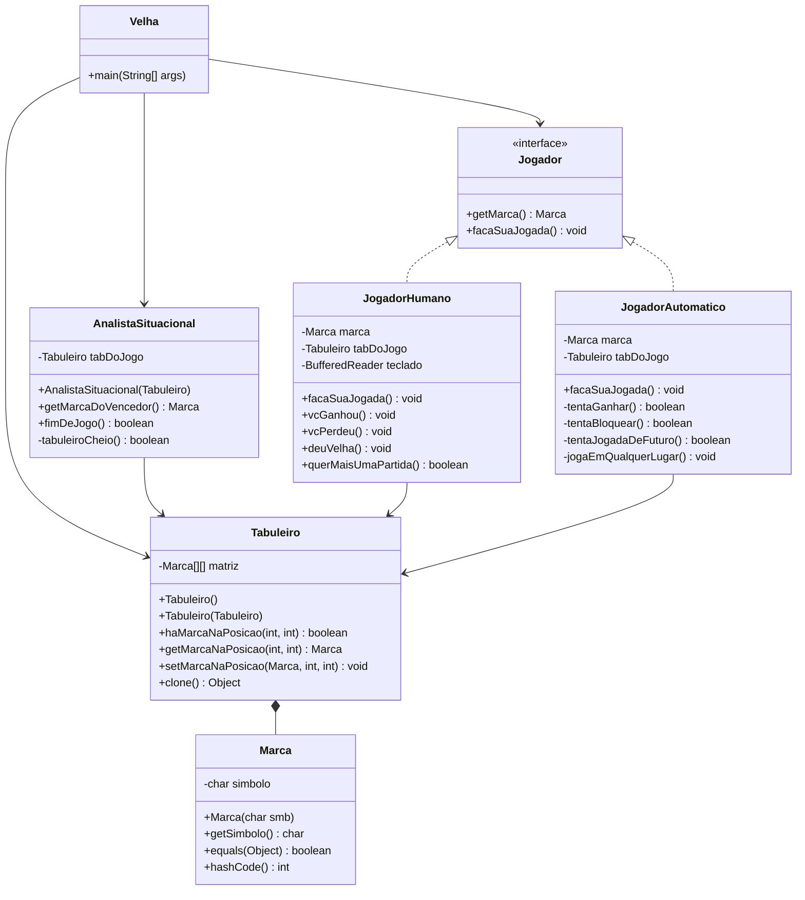

# 🎮 Jogo da Velha — POO em Java


> Trabalho da disciplina **Paradigma e Programação Orientada a Objetos**
> Curso: **Sistemas de Informação** — 4º semestre
> Instituição: **PUC-Campinas**

Implementação do clássico **Jogo da Velha** (Tic-Tac-Toe) em Java, com foco na aplicação
prática dos quatro pilares da Programação Orientada a Objetos: **abstração**,
**encapsulamento**, **herança** e **polimorfismo**.

O jogo coloca um **jogador humano** contra um **jogador automático** com uma IA baseada em
heurísticas (ganhar → bloquear → criar ameaças → jogar em qualquer lugar livre).

---

## 📋 Sumário

- [Funcionalidades](#-funcionalidades)
- [Demonstração](#-demonstração)
- [Arquitetura](#-arquitetura)
- [Conceitos de POO aplicados](#-conceitos-de-poo-aplicados)
- [Estrutura do projeto](#-estrutura-do-projeto)
- [Como compilar e executar](#-como-compilar-e-executar)
- [Como jogar](#-como-jogar)
- [Decisões de projeto](#-decisões-de-projeto)
- [Melhorias futuras](#-melhorias-futuras)
- [Autor](#-autor)
- [Licença](#-licença)

---

## ✨ Funcionalidades

- ✅ Partida entre **jogador humano** e **jogador automático (IA)**.
- 🎲 **Sorteio** de quem começa cada partida (humano ou IA).
- ✖️⭕ Escolha do símbolo (`X` ou `O`) — a IA fica com o símbolo oposto.
- 🧠 **IA com heurísticas** em ordem de prioridade:
  1. **Ganhar** — completa um trio com 2 marcas próprias + 1 vazio.
  2. **Bloquear** — impede que o adversário complete um trio.
  3. **Jogada de futuro** — cria ameaças em trios ainda sem marca do oponente.
  4. **Jogada aleatória** — qualquer posição vazia, como fallback.
- 🔁 **Repetição de partidas** sem reiniciar o programa.
- 🧾 Exibição formatada do tabuleiro a cada turno.
- 🛡️ Validação de entradas e posições inválidas.

---

## 🎬 Demonstração

```
 X | O |   
---------
   | X |   
---------
 O |   | X

Você ganhou!
Jogar novamente? (s/n):
```

---

## 🏗️ Arquitetura

O projeto segue uma separação clara de responsabilidades em **dois pacotes** (`jogo` e
`jogador`), mais uma classe de entrada (`Velha`). Cada classe tem uma **única
responsabilidade** (Princípio da Responsabilidade Única — SRP).



### Responsabilidades

| Classe | Pacote | Papel |
|---|---|---|
| **`Velha`** | *(default)* | Controlador do jogo — orquestra o fluxo da partida |
| **`Marca`** | `jogo` | Value Object imutável que representa `X` ou `O` |
| **`Tabuleiro`** | `jogo` | Modelo do estado do jogo — matriz 3×3 de `Marca` |
| **`AnalistaSituacional`** | `jogo` | Analisa o estado do tabuleiro (vencedor? empate?) |
| **`Jogador`** | `jogador` | Interface (contrato) para qualquer tipo de jogador |
| **`JogadorHumano`** | `jogador` | Jogador controlado por entrada do usuário |
| **`JogadorAutomatico`** | `jogador` | IA com heurísticas |

---

## 🧩 Conceitos de POO aplicados

### 1. **Abstração**
A interface `Jogador` abstrai o conceito genérico de "jogador", escondendo *como* cada
implementação decide sua jogada. O `Velha.main` **não precisa saber** se está lidando com
um humano ou uma IA.

### 2. **Encapsulamento**
- `Tabuleiro.matriz` é `private` — ninguém fora da classe pode corrompê-la.
- Toda validação de limites (`0` a `2`) e de ocupação fica concentrada em métodos internos.
- `Marca` é **imutável** (não tem setter): representa um valor, não um estado mutável.

### 3. **Herança**
`JogadorHumano` e `JogadorAutomatico` **herdam** o contrato da interface `Jogador`,
compartilhando o tipo comum e permitindo substituição uniforme no `Velha.main`.

### 4. **Polimorfismo**
No loop principal:

```java
jogador.facaSuaJogada();   // chamada polimórfica
```

O método executado varia conforme a instância concreta (`JogadorHumano` ou
`JogadorAutomatico`), sem que o controlador tenha que verificar `instanceof`.

### 5. **Contrato de igualdade (Value Object)**
Todas as classes de domínio (`Marca`, `Tabuleiro`, `JogadorHumano`,
`JogadorAutomatico`, `AnalistaSituacional`) sobrescrevem **`equals`** e **`hashCode`**
de forma **consistente** — dois tabuleiros com o mesmo conteúdo são iguais.

### 6. **Cópia segura (construtor de cópia + `clone`)**
Cada classe implementa:
- **Construtor de cópia** (`new Tabuleiro(outro)`) que faz **cópia profunda** dos dados;
- **`clone()`** delegando para o construtor de cópia.

Isso permite simulação segura (útil se a IA evoluir para *Minimax*).

### 7. **DRY (Don't Repeat Yourself)**
A IA foi implementada com **métodos auxiliares** (`tentaCompletar`,
`tentaJogadaDeFuturo`, `todosOsTrios`) em vez de 72 `if/else` aninhados. O
comportamento é o mesmo, mas o código é **legível, testável e extensível**.

---

## 📁 Estrutura do projeto

```
JogoDaVelha/
├── Velha.java
├── README.md
├── src/
│   ├── jogo/
│   └── jogador/
└── out/                    ← TUDO compilado aqui dentro
    ├── Velha.class
    ├── jogo/
    │   └── *.class
    └── jogador/
        └── *.class
```

> ⚠️ Os arquivos `.java` de `jogo` e `jogador` **devem** estar dentro de pastas com
> os mesmos nomes (pacotes), conforme exigido pelo Java.

---

## 🚀 Como compilar e executar

### Pré-requisitos
- **JDK 17** ou superior (testado com JDK 21).
- Terminal, ou uma IDE (IntelliJ, Eclipse, VS Code + Extension Pack for Java).

### Via terminal

Na **raiz do projeto** (onde está o `Velha.java`):

```bash
# 1. Compilar
javac -d out -sourcepath src Velha.java

# 2. Executar
java -cp out Velha
```

### Via IDE

1. Importe a pasta como projeto Java.
2. Marque `Velha.java` como classe com `main`.
3. Execute (Run ▶).

---

## 🕹️ Como jogar

1. Ao iniciar, **sorteia-se** quem começa: você ou a IA.
2. Digite **linha** e **coluna** entre `0` e `2` quando for sua vez:

   ```
   Linha (0-2): 1
   Coluna (0-2): 2
   ```

   A grade conceitual é:

   ```
   (0,0) | (0,1) | (0,2)
   ------+-------+------
   (1,0) | (1,1) | (1,2)
   ------+-------+------
   (2,0) | (2,1) | (2,2)
   ```

3. Posições ocupadas ou fora do intervalo são **rejeitadas** — o programa
   solicita novamente.
4. Ao final de cada partida, responda `s` para jogar novamente ou `n` para sair.

---

## 🎯 Decisões de projeto

### Por que uma interface `Jogador` e não uma superclasse abstrata?
Como as duas implementações não compartilham **estado nem código** (uma lê teclado, a
outra executa heurísticas), a interface é a abstração mais adequada. Se no futuro surgir
estado comum (ex.: contagem de vitórias), basta extrair uma classe abstrata — sem
quebrar o `Velha.main`.

### Por que `Marca` é imutável?
Representa um **valor** (`X` ou `O`). Imutabilidade traz segurança (pode ser
compartilhada entre cópias de tabuleiro sem risco de mutação acidental) e é uma boa
prática em POO.

### Por que `AnalistaSituacional` é separado do `Tabuleiro`?
Seguindo o **Princípio da Responsabilidade Única (SRP)**, o tabuleiro *armazena*
dados; quem *analisa* o estado é o analista. Isso facilita testes e evolução
independente (ex.: adicionar "quase-vitória" ao analista sem tocar no tabuleiro).

### Por que não usar `if/else` aninhados na IA?
A versão didática da heurística exigiria ~72 ramificações. A solução com métodos
auxiliares que percorrem os **8 trios** é **equivalente em comportamento**, mas muito
mais **legível, coesa e extensível**.

---

## 👤 Autores

- **Nome:** _[Leonardo Maciel Ferreira de Moraes]_
- **RA:** _[25013925]_
- **Nome** _[Nicollas Fabbio]_
- **RA:** _[25007563]_
- **Nome** _[Guillermo Neto]_
- **RA:** _[25009270]_
- **Curso:** Sistemas de Informação — 4º semestre
- **Instituição:** PUC-Campinas
- **Disciplina:** Paradigma e Programação Orientada a Objetos
- **Professor(a):** _[André Maligno]_

---

## 📄 Licença

Projeto desenvolvido para fins **acadêmicos** na PUC-Campinas.
